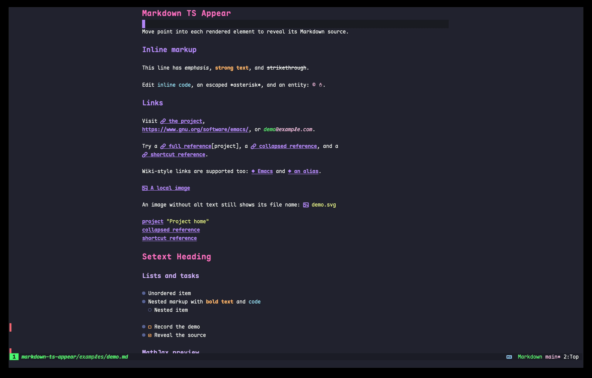

# markdown-ts-appear

<p align="center"><strong>Rendered while reading. Source when editing.</strong></p>

<p align="center">
<a href="https://elpa.nongnu.org/nongnu/markdown-ts-appear.html">
  
</a>
<a href="https://melpa.org/#/markdown-ts-appear">
  
</a>
<a href="https://github.com/Thysrael/markdown-ts-appear/actions/workflows/ci.yml"></a>
<a href="https://www.gnu.org/software/emacs/"></a>
<a href="COPYING"></a>
</p>



Can plain text keep its source while feeling almost rendered?

Reveal the Markdown source of the smallest element at point, then restore its
rendered appearance when point leaves.  This minor mode extends the built-in
`markdown-ts-mode` without changing buffer text.

Optional features include link icons, code fences, quote markers, callout
labels, width-aware table views, and LaTeX and diagram previews.

## Requirements

- Emacs 31.1+ with Tree-sitter support.
- The `markdown` and `markdown-inline` grammars.
- Math (optional): SVG support and either backend described [below](#math).
- Diagrams (optional): SVG image support and a registered renderer. The built-in
  Mermaid renderer uses [Mermaid CLI](https://github.com/mermaid-js/mermaid-cli)
  (`mmdc`) with its browser runtime.

## Installation

`markdown-ts-appear` is available from
**[NonGNU ELPA](https://elpa.nongnu.org/nongnu/markdown-ts-appear.html)**,
which is included in Emacs's default package archives. No additional archive
configuration is needed. Run `M-x package-refresh-contents`, then use:

```emacs-lisp
(use-package markdown-ts-appear
  :ensure t
  :pin nongnu
  :hook (markdown-ts-mode . markdown-ts-appear-mode))
```

Development snapshots are also available from [MELPA](https://melpa.org/#/markdown-ts-appear).
After [configuring MELPA](https://melpa.org/#/getting-started), omit `:pin nongnu`
from the example above to allow installation from MELPA.

Or install the latest Git revision:

```emacs-lisp
(use-package markdown-ts-appear
  :vc (markdown-ts-appear
       :url "https://github.com/Thysrael/markdown-ts-appear"
       :rev :newest)
  :hook (markdown-ts-mode . markdown-ts-appear-mode))
```

## Optional previews

Math and diagram previews are disabled by default. Normal previews require an
Emacs display with SVG image support; ordinary `emacs -nw` shows math source.

### Math

Math previews automatically use an available backend, preferring MathJax when
both are installed. Their rendering differs slightly.

- **MathJax**: GNU ELPA `mathjax` package and Node.js.
- **latex-to-svg**: `latex-to-svg-for-markdown` 0.22.2+ from MELPA and a
  [supported engine](https://github.com/alberti42/latex-to-svg#engine).

```emacs-lisp
(setopt markdown-ts-appear-enable-math-preview t)
```

For a live preview below display-math source, enable
`markdown-ts-appear-mathjax-edit-preview` with the MathJax backend.

#### Kitty terminal experiment

The `experiment/kitty-math-preview` branch adds an opt-in display adapter using
[kitty-graphics.el](https://github.com/cashmeredev/kitty-graphics.el), tested at
revision `13666d4eb2ef4eeed24697c0326368eff3667dce`. It reuses MathJax rendering
and caching; the adapter rasterizes transparent PNGs asynchronously and
kitty-graphics handles terminal placement. This terminal adapter supports only
MathJax, not the latex-to-svg backend.
It requires Kitty, ImageMagick, the GNU ELPA `mathjax` package, and Node.js.
Add kitty-graphics.el to `load-path`, then in a fresh terminal session configure
these options **before enabling** `markdown-ts-appear-mode`:

```emacs-lisp
(require 'kitty-graphics)
(kitty-graphics-mode 1)
(setopt markdown-ts-appear-enable-math-preview t
        markdown-ts-appear-math-renderer 'mathjax
        markdown-ts-appear-mathjax-terminal-preview t
        markdown-ts-appear-mathjax-edit-preview t)
```

Standalone display and ordinary inline formulas are supported. PNGs have a
transparent background and are scaled relative to terminal cell height;
`markdown-ts-appear-mathjax-scale` adjusts their size. Inline formulas fit one
terminal row with vertical breathing room and reveal source while editing.
PNGs use 4x raster resolution without enlarging their terminal placement.
Display previews center independently in each window (controlled by
`markdown-ts-appear-mathjax-center-display`); editing shows the source frame
above a centered preview. Editing previews for display formulas currently
need an empty line after the closing delimiter. Table math, mixed GUI/TTY
clients, and tmux are not yet validated. This is experimental: a source
integrity failure during terminal capability probing remains under investigation.
Placement tests cannot
establish absence of visual residue or flicker.

Run the isolated terminal check from this checkout inside Kitty:

```sh
TERM=xterm-256color KITTY_MATH_LOG=/path/to/result.log \
  emacs -nw -Q -L /path/to/kitty-graphics.el -l test/kitty-math-experiment.el
```

The check exercises source reveal, below-source idle updates, split windows,
scrolling, source integrity, cache reuse, and cleanup, then exits.
For an interactive scratch-buffer demo instead, use `-l test/try-kitty-math.el`.

### Diagrams

Install [Mermaid CLI](https://github.com/mermaid-js/mermaid-cli) and its browser
runtime, then enable:

```emacs-lisp
(setopt markdown-ts-appear-diagram-renderers
        '(("mermaid" . markdown-ts-appear-diagram-mmdc)))
```

Ensure `mmdc` can render a diagram on its own.  Puppeteer's
`PUPPETEER_EXECUTABLE_PATH` environment variable can select an existing Chrome
installation.  No additional Emacs package is required.

Register other SVG rendering functions with `markdown-ts-appear-diagram-renderers`.
Each registration enables previews for that fenced-block language. A renderer
receives `(LANGUAGE CODE THEME CALLBACK)` and calls the callback with SVG text,
or `nil` and an error message. It may return a zero-argument cancellation
function. See the option's docstring for the full contract.

To migrate, replace `markdown-ts-appear-enable-mermaid-preview` with the
registration above and rename `markdown-ts-appear-mermaid-size` to
`markdown-ts-appear-diagram-size`. For a custom executable previously set through
`markdown-ts-appear-mermaid-command`, register a wrapper that passes its path as
the optional fifth argument to `markdown-ts-appear-diagram-mmdc`. The old options
are no longer supported.

## Configuration

Use `setopt` or Customize for options, and `custom-set-faces` or Customize for
faces.  See `C-h v` and `M-x describe-face` for full documentation.

### Options

| Option | Default | Values and effect |
| --- | --- | --- |
| `markdown-ts-appear-heading-bullets` | `nil` | List of strings or characters, e.g. `'("◉" "○")`, cycled by ATX heading level; `nil` keeps normal rendering. |
| `markdown-ts-appear-link-icon` | `""` | String before ordinary links; empty disables it. |
| `markdown-ts-appear-image-icon` | `""` | String before image links; empty disables it. |
| `markdown-ts-appear-wikilink-icon` | `"◆"` | String before Wiki links; empty disables it. |
| `markdown-ts-appear-code-fence-style` | `connected` | `raw` or `connected` fences with a language label. |
| `markdown-ts-appear-block-quote-marker` | `"▎"` | Replacement string; `nil` keeps the original marker. |
| `markdown-ts-appear-render-callouts` | `t` | Show callout labels and faint backgrounds on the header line only. |
| `markdown-ts-appear-table-style` | `wrapped` | `raw`, `unicode`, or width-aware `wrapped` tables. |
| `markdown-ts-appear-table-reveal` | `row` | `row` reveals the current wrapped-table row; `table` reveals the whole table while editing. |
| `markdown-ts-appear-table-zebra-stripe` | `t` | Shade every second data row in `wrapped` tables. |
| `markdown-ts-appear-table-wrap-resize-delay` | `0.2` | Seconds to debounce `wrapped` table resize rendering. |
| `markdown-ts-appear-enable-math-preview` | `nil` | Enable the selected math provider. |
| `markdown-ts-appear-math-renderer` | `auto` | Prefer available MathJax; otherwise latex-to-svg. Can explicitly select `mathjax` or `latex-to-svg`. |
| `markdown-ts-appear-mathjax-edit-preview` | `nil` | Plain source while editing; `t` enables the optional framed preview below it. |
| `markdown-ts-appear-mathjax-delay` | `0.2` | Idle delay before reconciling edits; leaving a formula renders immediately. |
| `markdown-ts-appear-mathjax-scale` | `1.0` | Image scale relative to the source font's x-height. |
| `markdown-ts-appear-diagram-renderers` | `nil` | Language-to-function alist, e.g. `(("mermaid" . markdown-ts-appear-diagram-mmdc))`; registrations enable previews. |
| `markdown-ts-appear-diagram-size` | `source` | `source`: fit source height; positive integer: limit only width, in pixels. |

Visual options applied through `setopt` or Customize update active buffers.
Re-enable `markdown-ts-appear-mode` after changing the math preview-enable option.

### Faces

| Face | Purpose |
| --- | --- |
| `markdown-ts-appear-code-fence-marker` | Code block borders and language markers. |
| `markdown-ts-appear-label` | Inverse-video style for code language and callout labels. |
| `markdown-ts-appear-block-quote-marker` | Block quote markers. |
| `markdown-ts-appear-table` | Base font and appearance of wrapped tables; set its font for monospaced alignment. |
| `markdown-ts-appear-table-header` | Wrapped table header cells; bold by default. |
| `markdown-ts-appear-table-cell` | Data cells, underneath optional zebra shading. |
| `markdown-ts-appear-table-border` | Wrapped table borders, independent of row shading. |
| `markdown-ts-appear-table-zebra` | Alternating data-cell backgrounds in wrapped tables. |

Other colors and fonts follow `markdown-ts-mode` and the current theme.

## Modal Editing

By default, source is revealed whenever point enters an element.  To reveal
only in insert state, use one of these configurations.  State hooks are local
to each buffer and are removed when appear mode is disabled.

### Evil

[evil-collection](https://github.com/emacs-evil/evil-collection) includes this
integration, so no extra configuration is needed if you use it.  Otherwise:

```emacs-lisp
(defun my/markdown-appear-evil ()
  "Reveal Markdown source only in Evil insert state."
  (if markdown-ts-appear-mode
      (progn
        (add-hook 'evil-insert-state-entry-hook #'markdown-ts-appear-start nil t)
        (add-hook 'evil-insert-state-exit-hook #'markdown-ts-appear-stop nil t)
        (unless (eq (bound-and-true-p evil-state) 'insert)
          (markdown-ts-appear-stop)))
    (remove-hook 'evil-insert-state-entry-hook #'markdown-ts-appear-start t)
    (remove-hook 'evil-insert-state-exit-hook #'markdown-ts-appear-stop t)))

(add-hook 'markdown-ts-appear-mode-hook #'my/markdown-appear-evil)
```

### Meow

```emacs-lisp
(defun my/markdown-appear-meow ()
  "Reveal Markdown source only in Meow insert state."
  (if markdown-ts-appear-mode
      (progn
        (add-hook 'meow-insert-enter-hook #'markdown-ts-appear-start nil t)
        (add-hook 'meow-insert-exit-hook #'markdown-ts-appear-stop nil t)
        (unless (bound-and-true-p meow-insert-mode)
          (markdown-ts-appear-stop)))
    (remove-hook 'meow-insert-enter-hook #'markdown-ts-appear-start t)
    (remove-hook 'meow-insert-exit-hook #'markdown-ts-appear-stop t)))

(add-hook 'markdown-ts-appear-mode-hook #'my/markdown-appear-meow)
```

## Behavior Notes

- Enabling appear mode turns on `markdown-ts-hide-markup`.  Disabling it
  removes the buffer-local override and uses the current default value.
- Indirect buffers are unsupported; clones are detached from active tracking.
- Wrapped-table navigation skips hidden source characters. Revealing the row
  restores access to all of its source.
- Math detection, rendering, numbering, references and caching belong to
  `latex-to-svg`. Appear coordinates source reveal and restores the previous
  reveal setting on disable; independently enabled adaptors stay running.
  Wrapped table cells reuse its inline formula previews (`$...$` or `\(...\)`).
  Pending or failed formulas keep their source; wide previews shrink to fit the column.
- Diagrams render visible, unedited blocks through a shared queue, one job at a time.
  Identical diagrams share cached images; failed diagrams keep their source,
  with details available on hover.  Diagrams are only scaled down, preserving
  their aspect ratio, to fit the code block's displayed height by default, or
  the configured maximum width.  Editing shows the code at its natural height
  without padding.
- If preview setup fails, disable appear mode, fix the missing dependency, then
  re-enable it.

## Development

```sh
MARKDOWN_TS_APPEAR_REQUIRE_GRAMMARS=1 \
emacs --batch -Q \
  -l test/run-tests.el
```

Add `MARKDOWN_TS_APPEAR_REQUIRE_LATEX_TO_SVG=1` to require the optional math
packages. The real math rendering test needs SVG support and LaTeX + dvisvgm. Use
`MARKDOWN_TS_APPEAR_REQUIRE_MERMAID=1` to require the Mermaid CLI tests.
Without the corresponding
environment variable, tests with unavailable dependencies are skipped.

CI uses batch tests and real SVG rendering. Omit `--batch` to include graphical
interaction tests locally.

Run `python3 test/table-redisplay.py` to check actual terminal cursor positions
and Evil insert transitions.  This uses a real PTY and the supplied three-column
CJK regression table; it requires Python 3, Evil, and the Markdown grammars.

`test/benchmark-table.el` measures cold row entry, cached motion, and unchanged
window notifications.  Initialize packages and put the library to measure first
on `load-path`, then load that file; timings include garbage collection.

`test/benchmark-editing.el` measures typing, deletion, style-boundary movement
and table navigation, including redraw time. In a separate graphical Emacs:

```sh
APPEAR_BENCH_MODE=math emacs -Q \
  --eval '(progn (require (quote package)) (package-initialize))' \
  -L . -l test/benchmark-editing.el
```

Compare `native`, `appear` and `math` modes. The benchmark reports latency, GC
time and fontification/scan counts, then exits.

## License

GNU GPL version 3 or later.  See [COPYING](COPYING).
